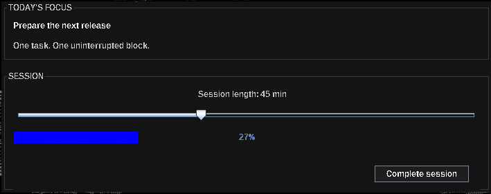
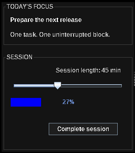
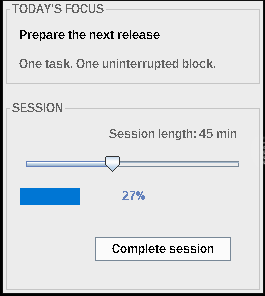
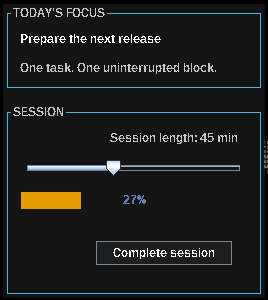

# Galeria de capturas

    <a href="../en/screenshots.md">🇬🇧 English</a>
    &nbsp;·&nbsp;
    <a href="capturas-de-tela.md"><strong>🇧🇷 Português</strong></a>

<a href="../../README.pt-BR.md">README do projeto</a>

As capturas mostram o resultado dos builders concisos da Aktissa em uma aplicação Swing em execução. As imagens atuais e futuras ficam reunidas aqui; adicione os novos arquivos PNG em `docs/assets/screenshots/` usando os nomes indicados abaixo.

## Gerenciador de tarefas

A demonstração interativa do repositório combina formulário, botões de opção, tabela, indicador de progresso e diálogos de confirmação.

    

## Sessão de foco

O exemplo independente `io.github.aktissa.demo.FocusSession` mostra uma tela interativa compacta com slider, barra de progresso e ação de conclusão.

    

## Componentes e layouts

A captura do gerenciador de tarefas acima também serve como exemplo de componentes e layouts: ela mostra controles de entrada, opções agrupadas, painéis com título, tabela e ações funcionando em conjunto. Não é necessário um print separado para este espaço.

## Temas prontos

Estas capturas mostram a mesma tela de sessão de foco em três temas incluídos:

<table>
    <tr>
        <td align="center"> <strong>Escuro</strong></td>
        <td align="center"> <strong>Claro</strong></td>
        <td align="center"> <strong>Daltonismo</strong></td>
    </tr>
</table>
